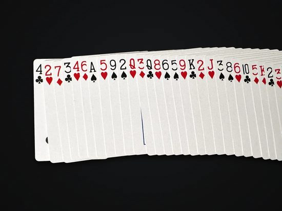

# StackyKit

**Playing-card recognition for iOS, macOS and Android, on the device.** Point a camera at cards and get each card's rank, suit, confidence and position, frame after frame. StackyKit reads a single card, a poker hand, cards dealt on a table, and a fanned or spread deck, down to indexes a few millimetres tall.

<p align="center">
  
</p>
<p align="center"><sub>Model v13 on every frame of a hand-held fan. Only sure readings get a label.</sub></p>

| Platform | Package | Runs on | Status |
|---|---|---|---|
| iOS 16+, macOS 13+ | Swift Package Manager | Core ML (Neural Engine) | Stable |
| Android 7+ (API 24) | Gradle, via JitPack | ONNX Runtime | Preview |

Both platforms run the same three networks and the same steps after them, so they read the same cards. No network calls, no account, and frames never leave the device.

## Contents

- [What it reads](#what-it-reads)
- [Quick start](#quick-start)
- [Get a model](#get-a-model)
- [Reading camera frames](#reading-camera-frames)
- [Cards, steady display and poker hands](#cards-steady-display-and-poker-hands)
- [Scanning a whole deck](#scanning-a-whole-deck)
- [Accuracy and limits](#accuracy-and-limits)
- [Tools, tests and the sample app](#tools-tests-and-the-sample-app)
- [Models, privacy and licence](#models-privacy-and-licence)

## What it reads

<table>
  <tr>
    <td width="33%"></td>
    <td width="33%"></td>
    <td width="33%"></td>
  </tr>
  <tr>
    <td><b>A single card.</b> Its name appears as soon as one index is read. When both corners show, they count as one card.</td>
    <td><b>A hand.</b> Up to seven cards; the best five-card poker hand is named.</td>
    <td><b>A whole deck.</b> Film along a spread, or take one photo of it. You get the order, and whether it is a known stack such as Mnemonica.</td>
  </tr>
</table>

How a frame is read:

1. **Find.** A box-finder marks every card index in the frame.
2. **Check.** A second network drops boxes that aren't indexes, such as big pips and face-card art.
3. **Read.** The reader names the rank and suit and says how sure it is. On the test set, sure readings are right about 97% of the time; unsure ones are marked, never guessed.
4. **Follow.** Frame memory tracks each corner from frame to frame so readings don't flicker, and a card's two indexes are merged into one card.
5. **Order** (deck scans only). Indexes are followed along the spread and each card is used once, so a misread can't repeat a card.

## Quick start

### iOS and macOS

In Xcode choose **File → Add Package Dependencies…** and enter `https://github.com/samoxin1974/StackyKit`. In a `Package.swift`:

```swift
.package(url: "https://github.com/samoxin1974/StackyKit", from: "0.1.0")
```

```swift
import StackyKit

let model  = try await StackyModel.load(from: modelFolder)   // once, off the main thread
let reader = try StackyReader(model: model)                  // one per camera stream

// In your AVCaptureVideoDataOutputSampleBufferDelegate:
let cards = reader.read(pixelBuffer, orientation: .right)    // unrotated portrait buffer
for c in cards where c.isSure {
    print(c.code, c.confidence, c.box)                       // QH 0.98 (412, 233, 38, 61)
}
```

Requirements: Xcode 15+. iPhone 12 or newer recommended; about 20–40 ms per frame on an iPhone 15 Pro.

### Android

```kotlin
// settings.gradle.kts
dependencyResolutionManagement {
    repositories { google(); mavenCentral(); maven("https://jitpack.io") }
}

// app/build.gradle.kts
dependencies {
    implementation("com.github.tdemers218.StackyKit:stackykit:0.2.0")
}
android {
    androidResources { noCompress += "onnx" }   // lets the model load straight from the APK
}
```

```kotlin
val model  = StackyModel.fromAssets(context, "stacky-v13")   // once, off the main thread
val reader = StackyReader(model)                             // one per camera stream

// In your CameraX ImageAnalysis.Analyzer (output format RGBA_8888):
val cards = reader.read(imageProxy.toStackyImage())          // turned upright for you
for (c in cards) if (c.isSure) Log.i("Stacky", "${c.code} ${c.confidence} ${c.box}")
```

Requirements: Android 7 (API 24) or newer; a recent mid-range phone or better for live video. Android-only details (CameraX setup, modules, the sample app) are in [android/README.md](android/README.md).

## Get a model

The code and the model ship separately, so a better model never needs a code change. Download a model folder from the [Releases](../../releases) page:

| Platform | Folder | Contents |
|---|---|---|
| iOS, macOS | `stacky-v13` | `detector`, `reader`, `check` (Core ML), `color.json`, `manifest.json` |
| Android, other platforms | `stacky-v13-onnx` | `detector.onnx`, `reader.onnx`, `check.onnx`, `model.json` |

- **Xcode:** add the folder as a **folder reference** (a blue folder: "Create folder references"). If Xcode treats the `.mlmodelc` files as group members, it tries to compile them as its own models.
- **Android:** put the four files in `app/src/main/assets/stacky-v13/`.

The thresholds live in the model's manifest, so updating the model means replacing the folder. If a model needs a newer StackyKit, loading it fails with an "unsupported model" error instead of reading wrongly.

## Reading camera frames

These rules are the same on both platforms:

- **Upright and never mirrored.** The model must see indexes as printed. With the front camera, mirror only your preview and flip the boxes to match it. Boxes come back in the upright image's pixels, origin top-left.
- **One thread at a time.** A reader keeps per-stream state (frame memory). Use one reader per camera stream.
- **Reset when the scene changes.** Call `reset()` when the camera flips, a new trick starts, or the model is swapped.
- **Resolution.** 1920×1080 frames work best. Indexes should be at least about 15 px tall.

Per platform:

| | iOS and macOS | Android |
|---|---|---|
| Camera frames | `read(pixelBuffer, orientation:)`. Unrotated portrait buffers from either camera: `.right`. Or set `videoRotationAngle = 90` and `isVideoMirrored = false` on the connection and pass `.up`. | `read(imageProxy.toStackyImage())`, which turns CameraX frames upright using `rotationDegrees`. |
| Photos | `read(cgImage)` | `read(bitmap.toStackyImage(), tiles = 2)` for photos over about 2000 px, so small indexes keep their detail |
| No frame memory (photos) | `StackyReader(model:, options: .init(frameMemory: false))` | `StackyReader(model, StackyReader.Options(frameMemory = false))` |

## Cards, steady display and poker hands

Every reading is a `StackyCard`:

| Property | Meaning |
|---|---|
| `code` | `"10S"`, `"QH"`, `"AC"`: rank (A 2–10 J Q K) + suit (C D H S) |
| `rank`, `suit`, `isRed` | the code split up |
| `confidence` | min(rank confidence, suit confidence), 0–1 |
| `isSure` | `confidence ≥` the model's `accept` threshold (0.7 for v13) |
| `box` | the index's box, in pixels of the upright frame |
| `otherIndexBox` | the same card's other index, when both were visible and merged |
| `trackID` (Swift), `trackId` (Kotlin); `framesSeen` | the same physical corner across frames |
| `rankProbabilities`, `suitProbabilities` | full distributions (A…K; C D H S) |
| `name`, `symbol` (Kotlin) | "Queen of Hearts", "Q♥" |

**Show unsure readings differently**, or ask for a better look. For a display that doesn't flicker, pass readings through `StackySteady`: a card shows after 3 sure reads within 0.8 s and stays for 0.9 s after it was last seen.

```swift
let steady = StackySteady()
let shown  = steady.update(cards)
```

```kotlin
val steady = StackySteady()
val shown  = steady.update(cards)
val hand   = PokerHand.best(shown.map { it.code })   // "Full House", "Kings full of Sixes"
```

## Scanning a whole deck

`StackyStackScanner` builds the order of a spread deck from many frames. It uses each card's position along the spread, not the order in which cards were seen, and it knows a deck holds each card once: showing a card again only makes its place surer, it never adds a duplicate.

It also follows **the order cards are shown in**. When cards come out one at a time (dealt onto a pile, or spread from hand to hand in front of the camera), there is no spread to line up yet, so the order is when each card first appeared. The scanner switches to this by itself (`isInShownOrder`). A place in this order counts as sure only when nothing else appeared at the same moment. Pass each frame's time to `feed` when replaying a video file.

<p align="center">
  
</p>
<p align="center"><sub>One photo of a spread deck, read by model v13: 54 indexes read, 49 of the 51 visible cards right, and the order recognised as Mnemonica.</sub></p>

```swift
let scanner = StackyStackScanner(deckSize: 52)
// Every frame, while the spread is filmed from one end to the other:
scanner.feed(reader.read(pixelBuffer, orientation: .right))

scanner.order              // [Place(index, code, isSure)]
scanner.missing            // cards not placed yet
scanner.sectionsToRescan   // runs of unsure places, with sure neighbours to point the user to
scanner.isLost             // frames stopped lining up: go back to cards already scanned
scanner.endFound           // the spread's last card was seen whole
scanner.confirm("7D", at: 12)
scanner.match()            // Mnemonica by default: probability, top card, cut
```

```kotlin
val scanner = StackyStackScanner(deckSize = 52)
scanner.feed(reader.read(frame.toStackyImage()))
scanner.order; scanner.missing; scanner.isLost; scanner.endFound
scanner.confirm("7D", 12)
scanner.match()

// Or one photo of the whole spread:
val places = StackyStackScanner.solvePhoto(photoReader.read(bitmap.toStackyImage(), tiles = 2))
```

Tips to give your users:

- Spread the cards so every index shows, and move along the spread at a steady pace.
- Go back over the sections the scanner marks.
- A deck is 52 cards unless you set `deckSize`.

**Platform differences.** These are still being ported:

| Feature | iOS, macOS | Android |
|---|---|---|
| `sectionsToRescan` | ✓ | coming |
| `solvePhoto` (one photo) | coming | ✓ |
| `PokerHand` | coming | ✓ |

## Accuracy and limits

StackyKit is still in training. The networks are retrained every few weeks on new footage, and each version reads more cards right than the last. To help with footage of your own decks, write to **tdmagicsupport@gmail.com**.

Known limits of v13:

- **Decks.** Trained on standard red and black indexes (Bicycle-style). Unusual faces, jumbo indexes and four-colour decks are untested.
- **Light.** Dim light reads worse than daylight. Keep the indexes lit.
- **Blur.** Very fast motion blurs indexes and lowers confidence. The reader then says "unsure"; it doesn't guess.
- **Pairing.** A card's two indexes are merged only when both are in frame and read alike.
- **Deck scans.** A card whose index never shows can't be placed. The scanner marks the gap so the user can show that section again.

## Tools, tests and the sample app

**Command line (macOS).** It reads photos and videos with any model folder:

```sh
swift run -c release stacky-read path/to/stacky-v13 photo.jpg clip.mov --fps 6
swift run -c release stacky-read path/to/stacky-v13 spread.mov --scan    # deck order + Mnemonica match
```

**Android sample app.** [`android/sample`](android/sample) is a camera app with three modes: Card, Hand and Deck. Put the model files in `android/sample/src/main/assets/stacky-v13/` and run `./gradlew :sample:installDebug` from `android/` with a phone connected.

**Tests.**

```sh
swift build -c release                         # iOS / macOS package and the stacky-read tool
cd android && ./gradlew :core:test             # Android logic tests, on any JVM
```

## Models, privacy and licence

**Models and versions.** The Releases page carries the free model. Each new release replaces it with a newer one. The manifest says which model you have (`model.name`).

**Privacy.** StackyKit makes no network calls. Frames are processed in memory and dropped.

**Licence.**

- **Code:** MIT (see `LICENSE`).
- **Models:** the free model is the version before the newest. Since v13, every network in a model folder is Stacky's own and MIT: the box-finder, the corner check and the reader. They were trained on Stacky's own labelled footage. The box-finder starts from torchvision's ImageNet MobileNetV3 weights (BSD-3-Clause); no YOLO or other AGPL code or weights are used. Older model folders with a YOLO detector still load (`detector_kind` "yolo"), but they aren't published.

